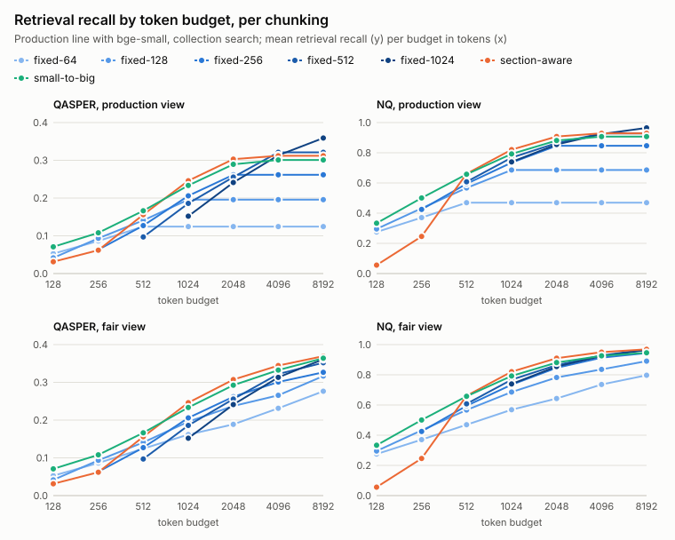
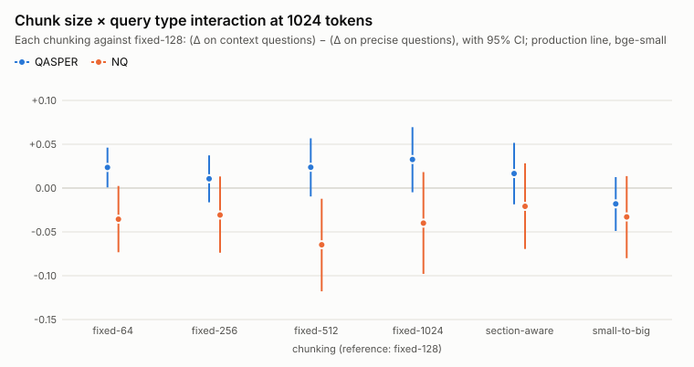
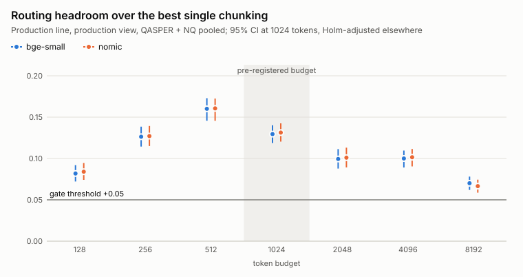

# rag-findings

**The question:** should a retrieval system index documents cut several ways and route each question to the cut that suits it?

**The answer: yes, build the router in v2.** A perfect per-question router would raise retrieval recall by about +0.13 over the best single chunking, for both embedders, with 95% confidence intervals well above the +0.05 bar fixed before the experiment ran. But the router has to learn from each question's own text: knowing only whether a question is "precise" or "context" gains nothing.

Full write-up, with every table and the method: [RAG chunking v1 results](chunking/2026-10-14-v1-results.md) (2026-10-14).

## What was measured

A **chunking** is one way of cutting documents into retrievable pieces. Every chunking gets the same **token budget**: the amount of retrieved text, counted in tokens, that a language model may read for one question, filled with whole chunks. The score is **retrieval recall**: the share of the text that answers the question (its labelled spans) that ends up inside that budget. A recall of 0.4256 means 42.56% of the answer text was retrieved.

- **Data:** 2,197 QASPER questions about 684 NLP research papers, and a 1,000-question subset of Natural Questions (questions from search logs, answered from Wikipedia pages).
- **Seven chunkings:** fixed windows of 64, 128, 256, 512 and 1024 tokens (**fixed-64** ... **fixed-1024**); **section-aware** (one chunk per document section, split at paragraph boundaries above 512 tokens); **small-to-big** (match small 128-token pieces, then return the whole section around a match when it still fits the budget).
- **Seven budgets** from 128 to 8192 tokens.
- **Search:** the **production line**, keyword (BM25) and vector search fused into one ranking, then a reranker reorders the top 30. It runs once per embedder (bge-small-en-v1.5 and nomic-embed-text-v1.5), with at most 8 chunks per question (the **production view**) and search over the whole collection.

## The decision in four numbers

Production line, production view, 1024-token budget, QASPER and Natural Questions pooled:

| | bge-small | nomic |
|---|---|---|
| Best single chunking (section-aware), retrieval recall | 0.4256 | 0.4262 |
| Perfect per-question router (an upper bound), retrieval recall | 0.5552 | 0.5575 |
| **Routing headroom** (router minus best single chunking) [95% CI] | **+0.1295 [+0.1187, +0.1402]** | **+0.1313 [+0.1204, +0.1425]** |
| Bar fixed in advance ([ADR 0002](docs/adr/0002-build-a-query-router-only-if-the-routing-headroom-threshold-is-met.md)): headroom of at least this, CI excluding 0 | +0.05, cleared | +0.05, cleared |

The perfect router picks the best chunking for each question in hindsight, so it is a ceiling, not what a real router will reach.

## Finding 1: the best single chunking depends on the budget



*Recall per budget for each chunking (production line, bge-small); in the capped view the small fixed windows flatten once 8 chunks fill less than the budget.*

- **512 tokens or less:** small-to-big wins (on Natural Questions alone, section-aware already edges ahead at 512 tokens).
- **1024 and 2048 tokens:** section-aware wins on both datasets and with both embedders. At 1024 tokens it retrieves 0.4256 pooled (bge-small) and is the best chunking in 0.9997 of the bootstrap resamples; small-to-big trails it by -0.0174 [-0.0277, -0.0070].
- **4096 and 8192 tokens:** with the 8-chunk cap the big fixed windows win (fixed-512, then fixed-1024), only because the cap stops smaller chunks from filling the room. Without the cap (the **fair view**) section-aware stays best from 1024 tokens up with bge-small; with nomic, fixed-1024 edges ahead at 8192.

## Finding 2: the kind of question does not pick the chunk size



*How much more each chunking gains over fixed-128 on context questions than on precise ones, at 1024 tokens; most CIs cross 0.*

A **precise** question is answered by one passage, a **context** question by several. The test: do bigger chunks help context questions more than precise ones?

- QASPER repeats an earlier pilot: fixed-512 against fixed-128 gives +0.0237 [-0.0096, +0.0568], a small effect whose CI spans 0. Natural Questions points the other way: -0.0647 [-0.1178, -0.0122]. Pooled, it disappears: +0.0106 [-0.0190, +0.0410].
- Section-aware is the best chunking for precise and for context questions alike, so a router that knew each question's type in hindsight would gain +0.0000 over section-aware, on every dataset and with both embedders.

## Finding 3: a router is worth building



*Routing headroom per budget, pooled, production line, production view; every CI sits above the +0.05 bar.*

- The headroom holds on each dataset alone at 1024 tokens (QASPER +0.1273, Natural Questions +0.1345 with bge-small), at every budget (largest at 512 tokens, +0.1601), and for every search variant, keyword-only included.
- It comes from question-by-question differences, not from the query type: on many QASPER questions no chunking finds the paper at all, and on the rest the best chunking varies per question in the same way for precise and context questions.

## What each part of the search adds

At 1024 tokens, production view, comparing each pipeline's best single chunking (differences between means; no CI is computed for them):

- **The reranker adds the most:** +0.0849 retrieval recall pooled with bge-small (+0.0764 with nomic) over hybrid search without it, on both datasets.
- **Hybrid fusion helps QASPER and hurts Natural Questions before the reranker:** fusing BM25 with vector search beats vector search alone on QASPER (+0.0366, bge-small) but costs -0.0532 (bge-small) and -0.0858 (nomic) on Natural Questions, where BM25 is much weaker.
- **The winner barely moves:** section-aware or small-to-big is the best chunking for every pipeline, embedder and dataset.

## What to use today, and what v2 does

**Use today:** section-aware chunks with a token budget around 1024 tokens, hybrid search plus the reranker over the top 30. Either embedder works; their recalls are within a few thousandths.

**v2:** index all seven chunkings and route each question to one from its text alone, judged where v1's gate was judged. The baseline is section-aware (0.4256 with bge-small), the ceiling is the perfect router (0.5552). v2 fixes its own success bar before it runs, keeps section-aware if no router clears it, and adds answer accuracy, LLM context prefixes and late chunking.

## Limitations

- Retrieval only: answer accuracy is not measured yet.
- The perfect router picks in hindsight from seven chunkings, so part of the headroom is noise.
- Two English sources (NLP papers and Wikipedia), one run per setup, one reranker depth (30), one fusion constant (k = 60).
- The reranker orders only the top 30; section-aware often packs chunks from past rank 30, so a deeper rerank could shift its margin either way.
- bge-small reads only 512 tokens and embeds longer chunks truncated; nomic reads 8192 and gives recalls within a few thousandths, so truncation moves no conclusion.
- The tables over one combined index of both datasets are BM25-only; the router decision pools the two per-dataset runs instead.

The write-up's [limitations section](chunking/2026-10-14-v1-results.md#5-limitations) has the details.

## Repository map

- [`chunking/2026-10-14-v1-results.md`](chunking/2026-10-14-v1-results.md): the v1 results write-up; its figures are in [`chunking/figures/`](chunking/figures).
- [`chunking/2026-10-10-chunk-size-vs-query-type.md`](chunking/2026-10-10-chunk-size-vs-query-type.md): the research report that motivated v1, covering the literature on chunk size versus query type, budget-matched evaluation, and a QASPER pilot.
- [`results/`](results): the committed result tables (`qasper/`, `nq/`, `pooled/`, `routing/`); every number above comes from them.
- [`configs/`](configs): the run configurations and the Natural Questions subset's id list.
- [`CONTEXT.md`](CONTEXT.md): the experiment's vocabulary.
- [`docs/adr`](docs/adr): the settled design decisions. [ADR 0004](docs/adr/0004-run-v1-on-the-settled-question-sets-and-chunking-grid-superseding-the-reports-proposal.md) supersedes the chunking grid proposed in the research report.
- [`src/rag`](src/rag) and [`tests`](tests): the experiment code and its unit tests.

## Setup

Requires Python 3.12 and [uv](https://docs.astral.sh/uv/).

```sh
uv run rag setup
```

`setup` downloads the QASPER dev and test tarballs (about 15 MB) and the Natural Questions dev config (seven parquet shards, about 1.34 GB; never the default config, whose train split is 57 GB) into the git-ignored `data/` directory and verifies their sha256 checksums. It also downloads the pinned model revisions (safetensors weights, tokenizers and configs only, about 1.2 GB) into the git-ignored `data/hf-cache/`; runs then load them offline (`--no-models` skips them).

Unit tests run offline on small committed fixtures: `uv run pytest`.

## Reproduce the results

### Re-render the write-up from the committed tables

The write-up's tables and figures are regenerated from `results/` without running any retrieval:

```sh
uv run rag writeup          # re-render the write-up's tables and figures
uv run rag writeup --check  # change nothing; fail if the write-up or a figure differs from results/
```

### Tracer experiment

A thin end-to-end retrieval eval: QASPER v0.3 to canonical documents to labelled spans to fixed 256-token chunks to BM25 retrieval to a 1024-token budget (production view), scored as retrieval recall and precision against the labelled spans.

```sh
uv run rag setup && uv run rag run configs/tracer.yaml
```

Then open `results/qasper/r1-tracer.md`. `run` writes per-question results and a run manifest to the git-ignored `runs/` directory (namespaced per dataset label) and regenerates the committed result table under `results/`.

### Grid: the production line and its ablations

Every chunking at every token budget on QASPER (and, with `configs/nq-grid.yaml`, on the Natural Questions subset below): fixed windows of 64, 128, 256, 512 and 1024 tokens (Chonkie's token chunker, cl100k_base, no overlap), section-aware chunks (one per section, split at paragraph boundaries above 512 tokens) and small-to-big (128-token children returning their section-aware parent when it fits the remaining budget); budgets of 128 to 8192 tokens; the production view (top-N cap 8, with a cap-5 side table) and the fair view (no cap); search across the whole collection and within the question's own document.

Each cell runs under four retrieval pipelines, two of them per embedder (bge-small-en-v1.5, 512-token input; nomic-embed-text-v1.5, 8192-token input with its `search_document:` / `search_query:` prefixes, which never count toward a budget):

- the production line (`hybrid-rerank`): BM25 and vector search fused by reciprocal rank fusion (k = 60), then gte-reranker-modernbert-base reorders the fused top 30; after them the list continues in fused order (the unreranked tail), deep enough to fill the fair view at 8192 tokens;
- the ablations: hybrid without the reranker, vector search only, and BM25 only.

Small-to-big matches, and the reranker scores, the 128-token children. Vector search is exact (cosine) over a LanceDB table per chunking and embedder, next to the full-text index. Chunk embeddings (keyed by model and chunk span) and reranker scores (keyed by question and chunk) are cached under `data/cache/`, so both scopes and both embedders share them and a re-run does no reranker passes.

```sh
uv run rag setup && uv run rag run configs/grid.yaml --sample 50   # a seeded 50-paper sample, minutes
uv run rag run configs/grid.yaml                                   # the full run, several hours on an M4 Max
```

A `--sample` run writes everything, its tables included, under `runs/qasper/grid-sample<N>/` and leaves `results/` untouched. The full run writes per-question results as Parquet under `runs/<dataset>/<run_name>/` (git-ignored; one row per question, pipeline, embedder, chunking, search scope, view, cap and budget, plus fixed-k rows and each question's query type), a manifest with the wall time, the truncation shares and the reranker's pass counts, and regenerates the committed tables, each with one block per pipeline and embedder, the production line first:

- `results/qasper/r2-grid.md` (R2): retrieval recall and precision per chunking and budget, production and fair view side by side, plus the cap-5 side table;
- `results/qasper/r3-grid.md` (R3): retrieval recall per query type (precise, context; mixed counted but left out of the contrast) and the difference between types;
- `results/qasper/r4-grid.md` (R4): fixed-k hit@k and recall@k at k = 1, 5 and 10, for comparison with the literature only;
- `results/qasper/r2w-grid.md` (R2w): R2 with search within the question's own document;
- `results/qasper/r5-grid.md` (R5): pipeline x embedder x chunking at each budget, with each chunking's share of chunks longer than the embedder's input limit (‡, embedded truncated) and how often packing reached the unreranked tail.

"n/a" marks a fixed chunking whose chunk is bigger than the budget (R5 gives every n/a its reason); "†" marks production-view cells where the top-N cap, not the budget, limits the retrieved text for at least half of the questions; "§" marks production-line cells where packing used the unreranked tail. A BM25-only grid (`pipeline: bm25`) still runs in a few minutes without any model.

### Natural Questions subset

A second dataset, so the chunk size × query type interaction and the routing headroom are not QASPER-only. `sample` picks 1,000 questions from the NQ dev config - 500 with a short answer (precise) and 500 long-answer-only (context) - from the questions where at least 2 of 5 annotators gave a long answer and at least one of those long answers is a paragraph (`<P>`); tables and lists are excluded. The selection ranks question ids by seeded sha256, and the resulting id list is committed as `configs/nq-subset.txt` (ids only, never dataset text, so the CC BY-SA 3.0 ShareAlike term never attaches to the repository) and reproduces the same subset.

```sh
uv run rag sample && uv run rag run configs/nq-tracer.yaml && uv run rag run configs/nq-grid.yaml
```

The canonical page text is the page's non-HTML tokens (tokens joined with spaces inside a paragraph, paragraphs joined with blank lines), with a map from token offsets to character offsets; the labelled span of every annotator whose long answer is a `<P>` paragraph is that paragraph, and short-answer spans are kept per annotator. Sections come from the page's heading tags, so section-aware chunks and small-to-big parents follow the page's own structure. The collection is the subset's 1,000 pages; whole-collection search runs over all of them and within-document search over the question's own page.

The NQ tracer and grid write the same R1-R5 and R2w tables under `results/nq/`, plus `results/nq/r6-grid.md` (R6): short-answer span recall by chunking and budget on the NQ precise questions that have a short-answer span, the same packing as R2 scored against the short-answer spans instead of the long-answer paragraph.

### Pooled runs

`configs/pooled-tracer.yaml` and `configs/pooled-grid.yaml` load QASPER (dev and test) and the NQ subset together: one collection, one retrieval run over both, and the same tables under `results/pooled/` (BM25 only: the production line and its ablations run per dataset), with each dataset's n kept visible (the Questions section of every pooled table breaks the query-type counts down per dataset).

```sh
uv run rag run configs/pooled-tracer.yaml && uv run rag run configs/pooled-grid.yaml
```

### Routing headroom

The analysis that decides whether v2 builds a query router, read from the grid runs' per-question results (no retrieval runs). Per dataset (and pooled when there are several), pipeline, embedder, budget and view: the best single chunking (highest mean retrieval recall), the oracle router (per question, the chunking with the highest recall; ties to the smaller chunk) and the routing headroom between them. A paired bootstrap over documents (10,000 resamples, fixed seed) re-selects the best single chunking inside every resample and gives 95% CIs at the pre-registered 1024-token budget, Holm-adjusted at the other budgets.

```sh
uv run rag run configs/grid.yaml && uv run rag run configs/nq-grid.yaml && uv run rag headroom configs/headroom.yaml
```

It takes seconds and regenerates the committed tables under `results/routing/`, byte-identically for the same seed and inputs:

- `r7-headroom.md` (R7): the router gate verdict per embedder (production line, production view, 1024 tokens, pooled QASPER + NQ: build the router if either embedder's headroom is at least +0.05 recall with a CI excluding 0), the routing headroom, a query-type oracle row (the best chunking per labelled query type; secondary, not part of the gate) and every chunking's difference from the best single chunking;
- `r8-headroom.md` (R8): the chunk size x query type interaction [Δ(chunking − fixed-128) | context] − [Δ(chunking − fixed-128) | precise];
- `r9-headroom.md` (R9): which chunking the oracle router picks, by query type, at 1024 tokens.

The committed tables read the QASPER and Natural Questions grid runs (`runs: [qasper/grid, nq/grid]`), pooled per question across the two runs, each dataset's documents resampled as its own clusters.

## Data, models and licences

No dataset text is committed; the repository holds only identifiers, character offsets, hashes, scores and result tables.

**Datasets**

- **QASPER** v0.3, dev and test splits: Dasigi et al., *A Dataset of Information-Seeking Questions and Answers Anchored in Research Papers*, NAACL 2021 ([arXiv 2105.03011](https://arxiv.org/abs/2105.03011)). Allen Institute for AI, licensed under [CC BY 4.0](https://creativecommons.org/licenses/by/4.0/).
- **Natural Questions**, dev config (the 1,000-question subset is listed by id in `configs/nq-subset.txt`): Kwiatkowski et al., *Natural Questions: a Benchmark for Question Answering Research*, TACL 2019 ([ACL Anthology Q19-1026](https://aclanthology.org/Q19-1026/)). Google, licensed under [CC BY-SA 3.0](https://creativecommons.org/licenses/by-sa/3.0/).

**Models**, each pinned to a Hugging Face revision:

| role | model | input limit | licence |
|---|---|---|---|
| embedder | [BAAI/bge-small-en-v1.5](https://huggingface.co/BAAI/bge-small-en-v1.5) (Beijing Academy of Artificial Intelligence) | 512 tokens | MIT |
| embedder | [nomic-ai/nomic-embed-text-v1.5](https://huggingface.co/nomic-ai/nomic-embed-text-v1.5) (Nomic AI) | 8192 tokens | Apache-2.0 |
| reranker | [Alibaba-NLP/gte-reranker-modernbert-base](https://huggingface.co/Alibaba-NLP/gte-reranker-modernbert-base) (Alibaba-NLP) | n/a | Apache-2.0 |

The pinned revisions are listed in the write-up's [data, models and licences section](chunking/2026-10-14-v1-results.md#data-models-and-licences).
