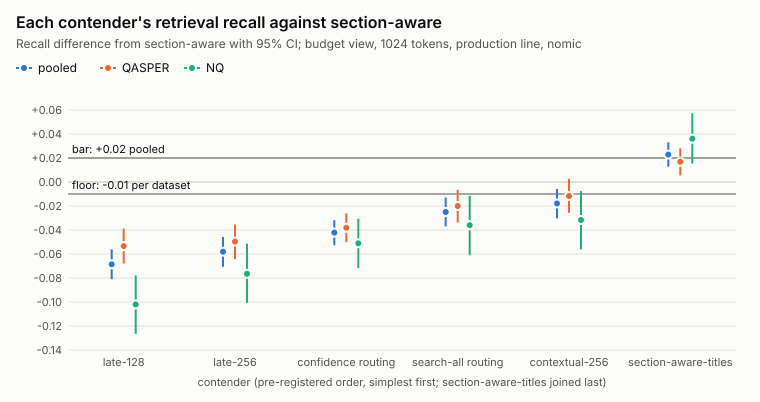
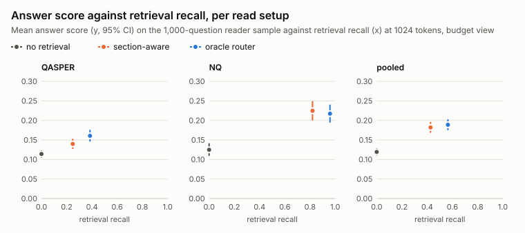

# RAG chunking v2: routing between chunkings, or indexing one chunking better?

Results write-up for the v2 experiment, 2026-10-18. It answers v2's question from the committed result tables under [`results/`](../results), next to the [v1 write-up](2026-10-14-v1-results.md). Every table and figure below is regenerated from those tables by `uv run rag writeup`, and `uv run rag writeup --check` fails if this file drifts from them, including any four-decimal number, percentage or time quoted in the prose. Terms in bold are defined in [CONTEXT.md](../CONTEXT.md); the design decisions are [ADR 0005](../docs/adr/0005-compare-routing-against-indexing-with-label-free-contenders-only.md) to [ADR 0009](../docs/adr/0009-measure-answer-accuracy-with-glm-5-3-flash-as-the-reader.md), read with their amendments.

---

## The answer in brief

v1 found that an **oracle router**, which picks the best of seven chunkings for every question in hindsight, retrieves about +0.13 more of the answer text than the **best single chunking**, section-aware. v2 asks where that headroom can be captured without labels: by **routing** each question between chunkings, or by **indexing** one chunking better.

1. **Indexing, not routing.** Neither label-free router captures any of the headroom; both lose recall against section-aware. The one contender that clears the bar fixed before any v2 run is an indexing change: section-aware's own chunks indexed with the dataset's document and section titles in front, for search only (**section-aware-titles**). It gains +0.0228 [+0.0128, +0.0331] pooled retrieval recall at 1024 tokens, on both datasets.
2. **The pre-registered verdict ([ADR 0008](../docs/adr/0008-pre-register-v2s-success-bar-and-tie-break.md), [R16](../results/v2/r16-verdict.md)): section-aware-titles replaces section-aware.** It is the only contender that passes, so the tie-break does not choose. Every other contender fails the gain and the per-dataset check: late chunking (late-128 -0.0686, late-256 -0.0581), confidence routing (-0.0422), search-all routing (-0.0250) and contextual chunks written by a local model (contextual-256, -0.0179), each with a 95% CI below 0.
3. **The ceiling is still there.** In v2's **budget view** the oracle router sits +0.1373 [+0.1263, +0.1485] above section-aware, against v1's +0.1313 [+0.1204, +0.1425] in the production view. Section-aware-titles captures 16.6% of it; the label-free routers capture less than nothing (search-all routing -18.2%, confidence routing -30.7%).
4. **More retrieved answer text moves answers less than recall suggests.** With a local Qwen3-8B as the **reader** on a 1,000-question sample, section-aware's chunks lift the **answer score** from 0.1193 with no retrieval to 0.1822, but the oracle router's chunks, +0.1373 more recall, add only +0.0067 [-0.0037, +0.0168]. Answers were read for section-aware, the oracle router and no retrieval only: no contender's answers were measured, the winner's included (section 4 says why).
5. **The answer score is a fair check on QASPER and a poor one on Natural Questions' short answers.** Against a model **grader**, QASPER's answer F1 agrees on 0.8467 of answers; Natural Questions' short-answer match agrees on only 0.3733 of precise answers, against 0.7733 for contains-a-reference. The pooled setup ranking holds under the grader.
6. **The winner costs nothing extra.** Section-aware-titles needs no model at index time, and its query path (embedding, searches, reranker) takes 859.5 ms on average against section-aware's 843.8 ms; search-all routing takes 1821.3 ms and confidence routing 5998.7 ms, because they rerank many more chunks.

## What to use today

Section-aware chunks indexed with their document and section titles: a token budget around 1024 tokens, hybrid search (BM25 and nomic-embed-text-v1.5, fused by reciprocal rank fusion) and the reranker over the fused top 30, with the title header in front of each chunk for BM25, the vectors and the reranker, and the plain chunk text handed to the reader. Do not build a label-free router over several chunkings: neither router tried here beats one well-indexed chunking, and both cost more at query time.

---

## The question and the design

v1's gate ([ADR 0002](../docs/adr/0002-build-a-query-router-only-if-the-routing-headroom-threshold-is-met.md)) cleared, so v2 was to build a router. But v1 also showed that the headroom does not come from the query type, and it may not come from routing at all: a chunk that carries more of its surroundings might capture the same gain from one index. v2 measures both kinds of contender against section-aware, end to end through a reader's answers where the reader stage reached them. The settled design:

- [ADR 0005](../docs/adr/0005-compare-routing-against-indexing-with-label-free-contenders-only.md): **label-free contenders only**, since labels for routing decisions do not exist for most corpora. Routing: **search-all routing** (search all seven chunkings' indexes, fuse, rerank the fused top 50, pack counting overlapping text once) and **confidence routing** (per question, the chunking whose top reranked chunk scores highest). Indexing: **late chunking** on fixed-128 and fixed-256 (each chunk's vector pooled from the token embeddings of its whole document, in windows of at most 8192 tokens) and **contextual chunks** on fixed-256 (a short context prefix per chunk written by a local model, used for search only). Its 2026-10-18 amendment adds section-aware-titles, the cheapest context enrichment: a header from the dataset's own titles that no model writes.
- [ADR 0006](../docs/adr/0006-make-the-budget-view-v2s-primary-view.md): the **budget view** is primary: as many reranked whole chunks as fit the **token budget**, at most 20 per question, so that small chunks are not held back by v1's cap of 8. v1's production view is reported alongside.
- [ADR 0007](../docs/adr/0007-use-nomic-embed-text-v1-5-as-v2s-primary-embedder.md): nomic-embed-text-v1.5 is the only embedder, because late chunking needs a model that reads whole documents (8192 tokens; bge-small reads 512).
- [ADR 0008](../docs/adr/0008-pre-register-v2s-success-bar-and-tie-break.md): the **success bar** and the **tie-break**, fixed before any v2 run (section 3). Its amendments drop the answer guard (2026-10-17), record that section-aware-titles cleared the retrieval part (2026-10-18), and fix how the 0.01 bounds are read (on point estimates, 2026-10-18).
- [ADR 0009](../docs/adr/0009-measure-answer-accuracy-with-glm-5-3-flash-as-the-reader.md): answer accuracy on a 1,000-question sample with one fixed prompt, checked by a model grader on 300 answers. Its 2026-10-17 amendment replaces the planned hosted reader with a local Qwen3-8B (4-bit MLX weights, thinking off, greedy decoding) and reads three setups: section-aware, the oracle router and no retrieval.

Everything else is v1's: the same QASPER and Natural Questions questions (3,197 pooled), the **production line** (BM25 and vector search fused by reciprocal rank fusion, k = 60, then gte-reranker-modernbert-base over the fused top 30), **collection search**, retrieval recall against the labelled spans, and the paired bootstrap that resamples documents (10,000 resamples, seed 0; 95% CIs at 1024 tokens, Holm-adjusted at other budgets). The indexing contenders keep the spans of the chunking they build on, so packing and scoring are unchanged and only the ranking differs; a contextual chunk's prefix and section-aware-titles' header are read by BM25, the embedder and the reranker, never by the reader, and never count against the budget.

## 1. The oracle ceiling in the budget view, against v1's

Before any contender ran, the baseline's seven chunkings were re-scored in the budget view with nomic ([R7, budget view](../results/routing/r7-v2-budget-view.md)), next to v1's production view with the same embedder ([R7](../results/routing/r7-headroom.md)):

<!-- generated: v2-ceiling -->
Production line, nomic, collection search:

| dataset | budget | v2, budget view: best single chunking | v2, budget view: oracle router | v2, budget view: routing headroom [CI] | v1, production view: best single chunking | v1, production view: oracle router | v1, production view: routing headroom [CI] | CI level |
|---|---|---|---|---|---|---|---|---|
| pooled | 128 | small-to-big 0.1512 | 0.2352 | +0.0840 [+0.0742, +0.0945] | small-to-big 0.1512 | 0.2352 | +0.0840 [+0.0742, +0.0945] | 99.17% |
| pooled | 256 | small-to-big 0.2296 | 0.3566 | +0.1271 [+0.1151, +0.1393] | small-to-big 0.2296 | 0.3566 | +0.1271 [+0.1151, +0.1393] | 99.00% |
| pooled | 512 | small-to-big 0.3173 | 0.4774 | +0.1601 [+0.1452, +0.1720] | small-to-big 0.3173 | 0.4779 | +0.1606 [+0.1456, +0.1725] | 98.75% |
| pooled | 1024 | section-aware 0.4269 | 0.5641 | +0.1373 [+0.1263, +0.1485] | section-aware 0.4262 | 0.5575 | +0.1313 [+0.1204, +0.1425] | 95.00% |
| pooled | 2048 | section-aware 0.4956 | 0.6021 | +0.1065 [+0.0945, +0.1190] | section-aware 0.4923 | 0.5933 | +0.1010 [+0.0892, +0.1131] | 98.33% |
| pooled | 4096 | section-aware 0.5325 | 0.6286 | +0.0962 [+0.0852, +0.1070] | fixed-512 0.5115 | 0.6131 | +0.1015 [+0.0904, +0.1115] | 97.50% |
| pooled | 8192 | fixed-1024 0.5584 | 0.6456 | +0.0872 [+0.0779, +0.0961] | fixed-1024 0.5573 | 0.6239 | +0.0666 [+0.0587, +0.0744] | 95.00% |
| QASPER | 1024 | section-aware 0.2480 | 0.3847 | +0.1367 [+0.1238, +0.1496] | section-aware 0.2471 | 0.3766 | +0.1294 [+0.1167, +0.1421] | 95.00% |
| NQ | 1024 | section-aware 0.8197 | 0.9583 | +0.1386 [+0.1184, +0.1594] | section-aware 0.8197 | 0.9551 | +0.1354 [+0.1154, +0.1559] | 95.00% |
<!-- end generated: v2-ceiling -->

- **Section-aware stays the best single chunking at 1024 tokens**, the bar's cell, on each dataset and pooled (0.4269 pooled, against 0.4262 in v1's production view). Lifting the cap from 8 to 20 chunks matters from 2048 tokens up, where it lets section-sized chunks fill the budget: section-aware is then also the best at 4096 tokens, where fixed-512 led in v1's production view.
- **The ceiling is a little higher than v1's**: +0.1373 [+0.1263, +0.1485] pooled at 1024 tokens, against +0.1313 [+0.1204, +0.1425], and about the same on each dataset alone (QASPER +0.1367, NQ +0.1386). This is the gap the contenders compete for; like v1's, it is an upper bound that no real router reaches.

## 2. Each contender's retrieval result



*Figure 1. Each contender's retrieval recall minus section-aware's at the bar's cell (budget view, 1024 tokens), pooled and per dataset, with 95% CIs. A contender passes when its pooled dot clears the +0.02 line with a CI above 0 and neither dataset's dot falls below -0.01. Values: [R16](../results/v2/r16-verdict.md).*

Each contender's recall at the bar's cell, from its own table ([R11](../results/pooled/r11-v2-routers.md) for the routers; [R12](../results/qasper/r12-v2-late.md), [R13](../results/qasper/r13-v2-contextual.md) and [R17](../results/qasper/r17-v2-titles.md) for the indexing contenders), and its difference from section-aware with the paired bootstrap's CIs from [R16](../results/v2/r16-verdict.md). The share of the oracle ceiling captured is (contender − section-aware) / (oracle router − section-aware):

<!-- generated: v2-contenders -->
Budget view (top-N cap 20), 1024 tokens, production line, nomic, collection search:

| setup | table | pooled recall | pooled difference from section-aware [95% CI] | QASPER difference [95% CI] | NQ difference [95% CI] | share of the oracle ceiling captured |
|---|---|---|---|---|---|---|
| section-aware (the reference) | R7 | 0.4269 | - | - | - | - |
| late-128 | R12 | 0.3582 | -0.0686 [-0.0810, -0.0561] | -0.0534 [-0.0678, -0.0388] | -0.1020 [-0.1265, -0.0779] | -50.0% |
| late-256 | R12 | 0.3688 | -0.0581 [-0.0707, -0.0458] | -0.0497 [-0.0642, -0.0355] | -0.0765 [-0.1007, -0.0514] | -42.3% |
| confidence routing | R11 | 0.3847 | -0.0422 [-0.0527, -0.0318] | -0.0382 [-0.0502, -0.0261] | -0.0511 [-0.0716, -0.0307] | -30.7% |
| search-all routing | R11 | 0.4018 | -0.0250 [-0.0370, -0.0129] | -0.0200 [-0.0337, -0.0066] | -0.0360 [-0.0610, -0.0115] | -18.2% |
| contextual-256 | R13 | 0.4089 | -0.0179 [-0.0303, -0.0058] | -0.0117 [-0.0257, +0.0025] | -0.0317 [-0.0562, -0.0076] | -13.1% |
| section-aware-titles | R17 | 0.4497 | +0.0228 [+0.0128, +0.0331] | +0.0168 [+0.0055, +0.0281] | +0.0361 [+0.0153, +0.0573] | 16.6% |
| oracle router (the ceiling) | R7 | 0.5641 | +0.1373 [+0.1263, +0.1485] | +0.1367 [+0.1238, +0.1496] | +0.1386 [+0.1184, +0.1594] | (the ceiling) |
<!-- end generated: v2-contenders -->

**Routing.** Both routers retrieve less than section-aware alone, on each dataset and pooled. Search-all routing, which reranks the fused top 50 of all seven indexes, trails by -0.0250 [-0.0370, -0.0129]; confidence routing trails by -0.0422 [-0.0527, -0.0318]. Confidence routing's picks show why: the chunking whose top chunk the reranker scores highest is not the one that packs the most answer text into the budget, and it picks fixed-64, the smallest chunks, most often (0.2856 of questions), section-aware for 0.2468 ([R11](../results/pooled/r11-v2-routers.md), share of questions and count):

<!-- generated: v2-confidence-picks -->
| dataset | fixed-64 | fixed-128 | fixed-256 | fixed-512 | section-aware | small-to-big | fixed-1024 | all |
|---|---|---|---|---|---|---|---|---|
| pooled | 0.2856 (913) | 0.0673 (215) | 0.0322 (103) | 0.0144 (46) | 0.2468 (789) | 0.2318 (741) | 0.1220 (390) | 3197 |
<!-- end generated: v2-confidence-picks -->

**Indexing.** Against the chunking each one builds on (same spans, only the ranking differs), the indexing contenders do different things:

<!-- generated: v2-own-reference -->
Recall difference, budget view, 1024 tokens (no CI is computed for these):

| contender - its own chunking | table | QASPER | NQ | pooled |
|---|---|---|---|---|
| late-128 - fixed-128 | R12 | -0.0039 | +0.0290 | +0.0064 |
| late-256 - fixed-256 | R12 | -0.0035 | +0.0082 | +0.0002 |
| contextual-256 - fixed-256 | R13 | +0.0345 | +0.0530 | +0.0403 |
| contextual-256-prefixed - contextual-256 | R13 | -0.0293 | -0.0649 | -0.0404 |
| section-aware-titles - section-aware | R17 | +0.0168 | +0.0361 | +0.0228 |
<!-- end generated: v2-own-reference -->

- **Late chunking barely changes small chunks**: +0.0064 for late-128 and +0.0002 for late-256 pooled, a little better on Natural Questions and a little worse on QASPER. It starts from fixed windows that trail section-aware by far, so it ends -0.0686 and -0.0581 below it.
- **Context prefixes help fixed-256 by +0.0403**, on both datasets (QASPER +0.0345, NQ +0.0530), but not past section-aware: contextual-256 stays -0.0179 [-0.0303, -0.0058] below. Handing the reader the prefix as well, so that it counts against the budget (contextual-256-prefixed, a side variant), takes the gain back: -0.0404 against contextual-256.
- **Titles help section-aware by +0.0228**, on both datasets (QASPER +0.0168, NQ +0.0361). It is the same idea as a contextual prefix, applied to the best single chunking and written from the dataset's own fields instead of by a model.

The gain does not hinge on the budget or the view. Section-aware-titles also clears section-aware at 512 tokens (+0.0183 [+0.0069, +0.0300]) and 2048 tokens (+0.0255 [+0.0144, +0.0368]), and by +0.0234 [+0.0133, +0.0336] in v1's production view; no other contender is above section-aware with a CI excluding 0 at any of these cells ([R16](../results/v2/r16-verdict.md), secondary results, which decide nothing):

<!-- generated: v2-budgets -->
Pooled recall difference from section-aware in the budget view at other budgets (the level column gives each interval's level):

| system | 512 difference | CI | level | 1024 difference | CI | level | 2048 difference | CI | level |
|---|---|---|---|---|---|---|---|---|---|
| late-128 | -0.0348 | [-0.0500, -0.0195] | 97.50% | -0.0686 | [-0.0810, -0.0561] | 95.00% | -0.0706 | [-0.0827, -0.0584] | 95.00% |
| late-256 | -0.0422 | [-0.0577, -0.0269] | 97.50% | -0.0581 | [-0.0707, -0.0458] | 95.00% | -0.0487 | [-0.0600, -0.0372] | 95.00% |
| confidence routing | -0.0626 | [-0.0762, -0.0491] | 97.50% | -0.0422 | [-0.0527, -0.0318] | 95.00% | -0.0573 | [-0.0673, -0.0471] | 95.00% |
| search-all routing | +0.0084 | [-0.0036, +0.0206] | 95.00% | -0.0250 | [-0.0370, -0.0129] | 95.00% | -0.0200 | [-0.0327, -0.0077] | 97.50% |
| contextual-256 | +0.0015 | [-0.0142, +0.0169] | 97.50% | -0.0179 | [-0.0303, -0.0058] | 95.00% | -0.0118 | [-0.0241, +0.0007] | 97.50% |
| section-aware-titles | +0.0183 | [+0.0069, +0.0300] | 95.00% | +0.0228 | [+0.0128, +0.0331] | 95.00% | +0.0255 | [+0.0144, +0.0368] | 97.50% |
| contextual-256-prefixed | -0.0915 | [-0.1081, -0.0752] | 97.50% | -0.0584 | [-0.0712, -0.0458] | 95.00% | -0.0358 | [-0.0469, -0.0248] | 95.00% |

The same at 1024 tokens in v1's production view (top-N cap 8):

| system | pooled difference | CI | qasper difference | nq difference |
|---|---|---|---|---|
| late-128 | -0.0680 | [-0.0804, -0.0556] | -0.0525 | -0.1020 |
| late-256 | -0.0574 | [-0.0701, -0.0451] | -0.0488 | -0.0765 |
| confidence routing | -0.0540 | [-0.0647, -0.0435] | -0.0489 | -0.0652 |
| search-all routing | -0.0266 | [-0.0385, -0.0146] | -0.0222 | -0.0361 |
| contextual-256 | -0.0173 | [-0.0296, -0.0052] | -0.0108 | -0.0317 |
| section-aware-titles | +0.0234 | [+0.0133, +0.0336] | +0.0177 | +0.0361 |
| contextual-256-prefixed | -0.0577 | [-0.0705, -0.0452] | -0.0401 | -0.0966 |
<!-- end generated: v2-budgets -->

## 3. The bar and the verdict

The bar, the tie-break and the verdict as [R16](../results/v2/r16-verdict.md) states them, judged mechanically from the runs; the bar and the order were fixed in [ADR 0008](../docs/adr/0008-pre-register-v2s-success-bar-and-tie-break.md) before any v2 run:

<!-- generated: v2-verdict -->
**Verdict: section-aware-titles replaces section-aware.**

Judged on the hybrid-rerank pipeline with nomic, collection search, budget view (top-N cap 20) at 1024 tokens, pooled over qasper and nq, with a 95% CI from the paired, document-clustered bootstrap (10000 resamples, seed 0).

The bar (ADR 0008, read as its amendments record):

1. Gain: pooled retrieval recall at least +0.0200 over section-aware, with the CI excluding 0.
2. Datasets: on each dataset alone, recall no worse than section-aware's by more than 0.0100 (point estimate, the CI reported beside it).
3. Answers: an answer score no worse than section-aware's by more than 0.0100 (point estimate), where the contender's answers were measured.

Tie-break: among the contenders that pass, the highest pooled recall wins unless a simpler one is within 0.0100 of it (point estimates). Simplest first: late-128, late-256, confidence routing, search-all routing, contextual-256, section-aware-titles. Section-aware stays if none passes.

The pre-registered order names late chunking, confidence routing, search-all routing and contextual chunks. section-aware-titles joined the contenders afterwards (ADR 0005 amendment, 2026-10-18) and is placed last, so it could never win a tie against a pre-registered contender.
<!-- end generated: v2-verdict -->

Each contender against the bar's three checks:

<!-- generated: v2-bar -->
| contender | pooled difference | CI | gain | datasets | answers | tie-break |
|---|---|---|---|---|---|---|
| late-128 | -0.0686 | [-0.0810, -0.0561] | fail | fail | not measured | does not enter |
| late-256 | -0.0581 | [-0.0707, -0.0458] | fail | fail | not measured | does not enter |
| confidence routing | -0.0422 | [-0.0527, -0.0318] | fail | fail | not measured | does not enter |
| search-all routing | -0.0250 | [-0.0370, -0.0129] | fail | fail | not measured | does not enter |
| contextual-256 | -0.0179 | [-0.0303, -0.0058] | fail | fail | not measured | does not enter |
| section-aware-titles | +0.0228 | [+0.0128, +0.0331] | pass | pass | not measured | wins: the only contender that passes |
<!-- end generated: v2-bar -->

- **Section-aware-titles passes the gain** (+0.0228, CI [+0.0128, +0.0331] excluding 0) **and the per-dataset check** (QASPER +0.0168 [+0.0055, +0.0281], NQ +0.0361 [+0.0153, +0.0573], both CIs wholly above 0, so it would pass under strict non-inferiority too). Its answer check reads "not measured" and decides nothing (section 4).
- **Every other contender fails both retrieval checks**: each pooled difference is below 0 with a CI excluding 0 (contextual-256's -0.0179 [-0.0303, -0.0058] is the closest), and each is more than 0.01 below section-aware on Natural Questions.
- **Section-aware-titles joined after the pre-registration.** It was added by the 2026-10-18 amendment to ADR 0005, after the other contenders' results were known, and judged against the same bar, fixed before it ran; it was placed last in the tie-break order, so it could never have won a tie against a pre-registered contender. Since it is the only one that passes, the order did not decide anything.

**A deeper rerank does not change the verdict.** The reranker orders only the top 30 of each list, and section-aware packs chunks from past that head for most questions. A side run reranked section-aware and section-aware-titles to depth 50 ([R16](../results/v2/r16-verdict.md)):

<!-- generated: v2-depth50 -->
Section-aware and section-aware-titles reranked to depth 50 (v2-depth50) next to depth 30 (v2-titles), at the bar's cell, pooled.

| system | recall, depth 30 | recall, depth 50 | depth 50 - depth 30 | CI |
|---|---|---|---|---|
| section-aware | 0.4269 | 0.4319 | +0.0051 | [+0.0006, +0.0096] |
| section-aware-titles | 0.4497 | 0.4529 | +0.0032 | [-0.0018, +0.0084] |

| rerank depth | section-aware-titles - section-aware | CI | per dataset | bar's retrieval checks |
|---|---|---|---|---|
| 30 | +0.0228 | [+0.0128, +0.0331] | qasper +0.0168, nq +0.0361 | pass |
| 50 | +0.0209 | [+0.0108, +0.0311] | qasper +0.0155, nq +0.0327 | pass |

Section-aware's budget-view list packs chunks from past the reranked head for 66.8% of questions at depth 30 and 58.2% at depth 50. A depth-50 rerank moves the margin from +0.0228 to +0.0209; it does not change whether the margin clears the bar's retrieval checks.
<!-- end generated: v2-depth50 -->

## 4. Answer accuracy

The reader stage ([R14](../results/v2/r14-answers.md)) asks whether better retrieval moves answers. Qwen3-8B answers every question of a 1,000-question sample (500 QASPER questions drawn by paper, 250 precise and 250 context Natural Questions pages; ids in [`configs/v2/reader-sample.txt`](../configs/v2/reader-sample.txt)) with one fixed prompt, from the chunks each setup packs into the budget view's 1024-token cell. No retrieval is the floor, answered with the closed-book variant of the prompt. The answer score is each dataset's standard metric: answer F1 for QASPER; for Natural Questions, short-answer match on precise questions and token F1 against the long-answer paragraph on context questions. CIs come from the paired bootstrap over documents.



*Figure 2. Each read setup's mean answer score (with its 95% CI) against its retrieval recall at 1024 tokens in the budget view. No retrieval reads nothing, so its recall is 0. Recall is over every question ([R7, budget view](../results/routing/r7-v2-budget-view.md)), the answer score over the 1,000-question reader sample ([R14](../results/v2/r14-answers.md)).*

<!-- generated: v2-answers -->
| dataset | setup | n | answer score | CI | difference from section-aware | CI |
|---|---|---|---|---|---|---|
| pooled | section-aware | 1000 | 0.1822 | [+0.1682, +0.1962] | - | - |
| pooled | oracle | 1000 | 0.1889 | [+0.1750, +0.2028] | +0.0067 | [-0.0037, +0.0168] |
| pooled | no-retrieval | 1000 | 0.1193 | [+0.1101, +0.1290] | -0.0628 | [-0.0760, -0.0496] |
| nq | section-aware | 500 | 0.2246 | [+0.1999, +0.2492] | - | - |
| nq | oracle | 500 | 0.2172 | [+0.1943, +0.2404] | -0.0074 | [-0.0257, +0.0102] |
| nq | no-retrieval | 500 | 0.1247 | [+0.1093, +0.1416] | -0.0998 | [-0.1233, -0.0764] |
| qasper | section-aware | 500 | 0.1398 | [+0.1269, +0.1530] | - | - |
| qasper | oracle | 500 | 0.1606 | [+0.1461, +0.1760] | +0.0208 | [+0.0112, +0.0308] |
| qasper | no-retrieval | 500 | 0.1140 | [+0.1045, +0.1233] | -0.0258 | [-0.0384, -0.0137] |

Natural Questions by query type (point estimates; precise questions also scored by contains-a-reference):

| setup | precise n | short-answer match | contains | context n | token F1 |
|---|---|---|---|---|---|
| section-aware | 250 | 0.1600 | 0.6560 | 250 | 0.2891 |
| oracle | 250 | 0.1240 | 0.7000 | 250 | 0.3104 |
| no-retrieval | 250 | 0.0520 | 0.2800 | 250 | 0.1974 |
<!-- end generated: v2-answers -->

- **Retrieval helps the reader**: section-aware's chunks raise the pooled answer score from 0.1193 to 0.1822 (no retrieval -0.0628 [-0.0760, -0.0496]), most on Natural Questions (-0.0998 for no retrieval there).
- **The oracle router's extra recall barely reaches the answers**: +0.0067 [-0.0037, +0.0168] pooled, with a CI spanning 0. On QASPER it helps (+0.0208 [+0.0112, +0.0308]); on Natural Questions it does not (-0.0074 [-0.0257, +0.0102]), where section-aware already retrieves most of the answer text. Natural Questions by query type shows part of the reason: on precise questions the oracle's chunks contain a reference answer more often (0.7000 against 0.6560) but match a short answer exactly less often (0.1240 against 0.1600), which section 5 traces to the metric.
- **No contender's answers were measured, including the winner's.** The answer guard of ADR 0008 only ever decided between contenders that pass on retrieval; when no contender had passed, its 2026-10-17 amendment dropped it and the reader stage was cut to the three setups above. Section-aware-titles ran after that, so whether its +0.0228 retrieval gain moves answers is not known. On the evidence of the oracle router, whose +0.1373 recall moves the pooled answer score by a CI spanning 0, a gain of that size would be hard to see in answers on a 1,000-question sample.

## 5. The grader check

A model grader checked whether the answer score tracks correctness ([R15](../results/v2/r15-grader.md)): 100 seeded questions (50 per dataset, Natural Questions half precise and half context) times the three setups, 300 answers, each graded pass or fail by Claude Sonnet with a grader prompt committed before any answer existed. The answer score counts as a pass at 0.5 or above (short-answer match: an exact match), and agrees when that matches the grader.

<!-- generated: v2-grader -->
AUC: the chance that a random answer the grader passes has a higher answer score than a random one it fails, ties counting half (1.0: the score separates them perfectly; 0.5: no better than chance).

| dataset | answers | grader pass rate | mean answer score | mean score, passes | mean score, fails | AUC | agreement |
|---|---|---|---|---|---|---|---|
| pooled | 300 | 0.4233 | 0.1430 | 0.2046 | 0.0977 | 0.6037 | 0.6167 |
| qasper | 150 | 0.1800 | 0.1221 | 0.2592 | 0.0920 | 0.8097 | 0.8467 |
| nq | 150 | 0.6667 | 0.1639 | 0.1899 | 0.1118 | 0.5654 | 0.3867 |
| nq precise | 75 | 0.6800 | 0.0533 | 0.0784 | 0.0000 | 0.5392 | 0.3733 |
| nq context | 75 | 0.6533 | 0.2744 | 0.3059 | 0.2150 | 0.6962 | 0.4000 |

Natural Questions precise questions scored by contains-a-reference instead: agreement 0.7733, AUC 0.8002, mean of passes 0.7255 against fails 0.1250.

| dataset | setup | answers | grader pass rate | mean answer score | agreement |
|---|---|---|---|---|---|
| pooled | section-aware | 100 | 0.5400 | 0.1657 | 0.5200 |
| pooled | oracle | 100 | 0.4700 | 0.1494 | 0.5700 |
| pooled | no-retrieval | 100 | 0.2600 | 0.1139 | 0.7600 |
| qasper | section-aware | 50 | 0.2600 | 0.1279 | 0.7800 |
| qasper | oracle | 50 | 0.1800 | 0.1338 | 0.8600 |
| qasper | no-retrieval | 50 | 0.1000 | 0.1047 | 0.9000 |
| nq | section-aware | 50 | 0.8200 | 0.2035 | 0.2600 |
| nq | oracle | 50 | 0.7600 | 0.1649 | 0.2800 |
| nq | no-retrieval | 50 | 0.4200 | 0.1232 | 0.6200 |

Does the setup ranking hold under the grader?

| dataset | by mean answer score | by grader pass rate | same order |
|---|---|---|---|
| pooled | section-aware > oracle > no-retrieval | section-aware > oracle > no-retrieval | yes |
| qasper | oracle > section-aware > no-retrieval | section-aware > oracle > no-retrieval | no |
| nq | section-aware > oracle > no-retrieval | section-aware > oracle > no-retrieval | yes |
<!-- end generated: v2-grader -->

- **On QASPER the answer score is a fair check**: answer F1 agrees with the grader on 0.8467 of answers, and separates passes from fails with an AUC of 0.8097.
- **On Natural Questions it is not**: agreement is 0.3867 overall, and 0.3733 on precise questions, where the grader passes most answers that do not match a short answer exactly. Scored by contains-a-reference instead, precise questions agree on 0.7733 (AUC 0.8002). Exact match fails any answer that is not exactly a reference after normalisation, so a right answer with extra words counts as wrong.
- **The pooled setup ranking holds under the grader** (section-aware, then the oracle router, then no retrieval), and so does Natural Questions'. On QASPER the grader ranks section-aware above the oracle router (pass rates 0.2600 and 0.1800) where the answer score ranks them the other way round (0.1279 against 0.1338 on the graded questions), on 50 questions per setup.

## 6. Adoption profile

What each contender costs per question and at index time ([R16](../results/v2/r16-verdict.md)). Query path, uncached, on one machine:

<!-- generated: v2-latency -->
Milliseconds per question, mean / median / p90, over 100 seeded questions (50 nq, 50 qasper; seed 0), after 1 untimed warm-up question per system. Every query vector and reranker score is computed by the model (the embedding and score caches are not used); searches run over the runs' own indexes, 1000 deep. Probe config hash `eaece7587765084e81c5450701c5abd356f814257914faddb6749c40ea841449`.

| system | searches | reranker pairs (mean) | query embedding ms | searches ms | reranker ms | total ms |
|---|---|---|---|---|---|---|
| section-aware | 2 | 30.0 | 12.0 / 9.3 / 12.6 | 27.7 / 22.1 / 31.1 | 804.1 / 743.1 / 1101.1 | 843.8 / 787.2 / 1167.7 |
| late-128 | 2 | 30.0 | 10.6 / 9.7 / 13.8 | 35.7 / 29.0 / 41.7 | 269.8 / 262.6 / 333.2 | 316.1 / 294.3 / 373.5 |
| late-256 | 2 | 30.0 | 9.8 / 9.0 / 11.9 | 33.3 / 21.7 / 33.4 | 494.4 / 471.2 / 594.7 | 537.5 / 506.5 / 636.9 |
| confidence routing | 14 | 204.1 | 10.1 / 9.2 / 13.6 | 227.0 / 195.0 / 327.3 | 5761.6 / 5562.8 / 6949.4 | 5998.7 / 5807.6 / 7351.4 |
| search-all routing | 14 | 50.0 | 9.1 / 9.0 / 10.4 | 204.6 / 199.8 / 301.3 | 1607.6 / 1504.5 / 2137.3 | 1821.3 / 1721.3 / 2353.1 |
| contextual-256 | 2 | 30.0 | 10.1 / 9.4 / 12.0 | 27.0 / 22.4 / 30.7 | 605.3 / 583.5 / 711.5 | 642.4 / 623.7 / 756.5 |
| section-aware-titles | 2 | 30.0 | 10.3 / 9.4 / 12.4 | 29.9 / 23.0 / 35.8 | 819.3 / 748.7 / 1104.8 | 859.5 / 789.8 / 1148.1 |

- hardware: machine Mac16,6, chip Apple M4 Max, memory 36 GB, os macOS 27.0.1, device mps
- versions: chonkie 1.7.0, lancedb 0.40.0, pyarrow 26.0.0, python 3.12.11, pyyaml 6.0.3, rag-findings 0.1.0, sentence-transformers 5.7.0, tiktoken 0.14.0, torch 2.14.1, transformers 4.57.6
- models: embedder `nomic-ai/nomic-embed-text-v1.5@e9b6763023c676ca8431644204f50c2b100d9aab`, reranker `Alibaba-NLP/gte-reranker-modernbert-base@f7481e6055501a30fb19d090657df9ec1f79ab2c`
<!-- end generated: v2-latency -->

<!-- generated: v2-costs -->
Index-time cost:

- qasper: section-aware indexes 12850 chunks; search-all and confidence routing index all 7 chunkings, 147935 chunks.
- nq: section-aware indexes 33915 chunks; search-all and confidence routing index all 7 chunkings, 401638 chunks.
- qasper: late chunking reads every document whole, 759 windows of at most 8192 tokens over 697 documents, one embedding pass serving late-128 and late-256.
- nq: late chunking reads every document whole, 1574 windows of at most 8192 tokens over 1000 documents, one embedding pass serving late-128 and late-256.
- contextual-256: one prefix per fixed-256 chunk written by `mlx-community/Qwen3-8B-4bit@545dc4251c05`, 49690 chunks in 30.4 h of generation (qasper 7.6 h, nq 22.8 h).
- section-aware-titles: a header per chunk from the dataset's own document and section titles; no model.

Reader cost per question:

- no-retrieval: 0.66 s per answer, 31 prompt tokens on average (mlx-community/Qwen3-8B-4bit@545dc4251c05440727734bcd94334791f6ab0192, local, no per-call cost).
- oracle: 3.29 s per answer, 1105 prompt tokens on average (mlx-community/Qwen3-8B-4bit@545dc4251c05440727734bcd94334791f6ab0192, local, no per-call cost).
- section-aware: 3.52 s per answer, 1095 prompt tokens on average (mlx-community/Qwen3-8B-4bit@545dc4251c05440727734bcd94334791f6ab0192, local, no per-call cost).
<!-- end generated: v2-costs -->

- **The reranker is the query-time cost.** Section-aware spends 804.1 ms of its 843.8 ms in the reranker, which reads 30 section-sized chunks; late-128 is the fastest (316.1 ms) because its 30 chunks are short. Section-aware-titles costs about the same as section-aware (859.5 ms): its header makes each reranker pair a little longer.
- **Routing multiplies the work.** Search-all routing runs 14 searches and reranks 50 chunks (1821.3 ms); confidence routing reranks every chunking's top 30, about 204 pairs (5998.7 ms). Both also index all seven chunkings: 147935 chunks on QASPER against section-aware's 12850.
- **Index time.** Section-aware-titles needs no model: its header comes from the dataset's own fields. Contextual chunks need a language model call per chunk: 30.4 h of local generation for 49690 prefixes. Late chunking needs one embedding pass over every document.
- **Reading.** The local reader takes 3.52 s per answer with section-aware's chunks (0.66 s with no retrieval) on the same machine, with no per-call cost.

## 7. Limitations

- **One small local reader and one fixed prompt.** The reader is Qwen3-8B in 4-bit MLX weights, thinking off, greedy decoding, at most 256 new tokens, with the same prompt for every setup; a larger reader, another prompt or thinking on could turn retrieved text into answers differently. The answers are generated locally and cached by prompt, so a re-run reads the cache; no answer or prompt is committed.
- **Answers for three setups only.** The reader read section-aware, the oracle router and no retrieval. No contender's answers were measured, so the winner's retrieval gain is not shown to reach answers.
- **The answer metrics.** Natural Questions' short-answer exact match agrees with the grader on only 0.3733 of precise answers (section 5), so Natural Questions' precise-question scores understate answers the grader accepts. The grader itself is one model on 300 answers.
- **The prefix model and its windows.** contextual-256's prefixes come from one local model (Qwen3-8B, 4-bit, greedy, thinking off, at most 120 new tokens) with one prompt. A document longer than 8192 tokens is given to it in windows of whole chunks, so a chunk's prefix sees only its window, not the whole document:

<!-- generated: v2-windows -->
| dataset | documents | prefix model: documents read in windows of at most 8192 tokens | prefixes cut at 120 tokens | late chunking: windows of at most 8192 nomic tokens |
|---|---|---|---|---|
| QASPER | 697 | 38 | 0 | 759 |
| NQ | 1000 | 398 | 3 | 1574 |

Late chunking's single-chunk check against the real model:

| chunking | pooling | min cosine | median cosine | >= 0.9999 |
|---|---|---|---|---|
| late-128 | every token the model read (the mechanism) | 1.000000 | 1.000000 | pass |
| late-128 | shipped rule (prefix and specials out) | 0.999798 | 0.999843 | recorded below the bar |
| late-256 | every token the model read (the mechanism) | 1.000000 | 1.000000 | pass |
| late-256 | shipped rule (prefix and specials out) | 0.999946 | 0.999955 | pass |
<!-- end generated: v2-windows -->

- **Late chunking's windows for long pages.** A document longer than nomic's 8192 tokens is embedded in several windows (the table above), so a late chunk carries only its own window's context, not the whole page. The pooling rule leaves the document prefix and special tokens out of every chunk, which keeps a window holding one late-128 chunk just under the 0.9999 cosine check against the chunk's own vector (the table above), as designed.
- **The reranker reads prefixes and headers.** For contextual-256 and section-aware-titles the reranker scores the question against the prefix or header plus the chunk, as do BM25 and the vectors. Their gains are those of the whole search line; how much comes from the reranker alone was not measured.
- **Tie order between duplicate chunks.** Some Natural Questions pages hold byte-identical chunks at the same span on different pages, which the reranker scores exactly equally, so tie order decides which copy is packed. Against v1 this moved three v2-baseline cells by one question each, within ±0.001 ([note](../results/nq/v2-baseline-regression.md)); a re-run can differ the same way at a few cells.
- **Section-aware-titles joined after the pre-registration.** It was judged against the bar fixed before any v2 run and placed last in the tie-break order, but it was proposed after the other contenders' results were known.
- **The unreranked tail.** Section-aware packs chunks from past the reranked head for most questions (66.8% at depth 30, section 3). A depth-50 rerank narrows section-aware-titles' margin a little and keeps it above the bar; other depths were not run.
- **One run per setup**, one embedder (nomic-embed-text-v1.5), one fusion constant (k = 60), and two English sources: NLP papers and Wikipedia. The latency profile is one machine's measurement and differs on a re-run.

## Reproducing the tables and figures

The tables here read the committed result tables only; no retrieval, reader or bootstrap runs.

```sh
uv run rag writeup          # re-render the tables and figures of the v1 and v2 write-ups
uv run rag writeup --check  # change nothing; fail if either write-up or a figure differs from results/
```

The result tables themselves come from the v2 runs listed, in order, in the [README](../README.md#the-v2-runs-in-order).

## Data, models and licences

**Datasets.** No dataset text is quoted here, and no reader answer, prompt or context prefix is committed; the repository holds only identifiers, character offsets, hashes, scores and result tables.

- **QASPER** v0.3, dev and test splits: Dasigi, Lo, Beltagy, Cohan, Smith and Gardner, *A Dataset of Information-Seeking Questions and Answers Anchored in Research Papers*, NAACL 2021 ([arXiv 2105.03011](https://arxiv.org/abs/2105.03011)). Allen Institute for AI, licensed under [CC BY 4.0](https://creativecommons.org/licenses/by/4.0/).
- **Natural Questions**, dev config (the 1,000-question subset is listed by id in `configs/nq-subset.txt`): Kwiatkowski et al., *Natural Questions: a Benchmark for Question Answering Research*, TACL 2019 ([ACL Anthology Q19-1026](https://aclanthology.org/Q19-1026/)). Google, licensed under [CC BY-SA 3.0](https://creativecommons.org/licenses/by-sa/3.0/).

**Models**, the open ones pinned to a Hugging Face revision:

<!-- generated: v2-models -->
| role | model | revision | licence |
|---|---|---|---|
| embedder | nomic-ai/nomic-embed-text-v1.5 | `e9b6763023c676ca8431644204f50c2b100d9aab` | Apache-2.0 |
| reranker | Alibaba-NLP/gte-reranker-modernbert-base | `f7481e6055501a30fb19d090657df9ec1f79ab2c` | Apache-2.0 |
| context prefixes | mlx-community/Qwen3-8B-4bit | `545dc4251c05440727734bcd94334791f6ab0192` | Apache-2.0 |
| reader | mlx-community/Qwen3-8B-4bit | `545dc4251c05440727734bcd94334791f6ab0192` | Apache-2.0 |
| grader (the check only) | claude-sonnet-5-5 | n/a (a hosted model) | proprietary (Anthropic) |
<!-- end generated: v2-models -->

- [nomic-ai/nomic-embed-text-v1.5](https://huggingface.co/nomic-ai/nomic-embed-text-v1.5), Nomic AI, Apache-2.0.
- [Alibaba-NLP/gte-reranker-modernbert-base](https://huggingface.co/Alibaba-NLP/gte-reranker-modernbert-base), Alibaba-NLP, Apache-2.0.
- [mlx-community/Qwen3-8B-4bit](https://huggingface.co/mlx-community/Qwen3-8B-4bit), a 4-bit MLX conversion of Qwen3-8B by the Qwen team, Alibaba Cloud, Apache-2.0: the context-prefix model and the reader.
- Claude Sonnet, Anthropic, through the `claude` command-line tool: the grader of the model-graded check only, never a paid API; the model that served each verdict is recorded in [`results/v2/grader-manifest.json`](../results/v2/grader-manifest.json).
